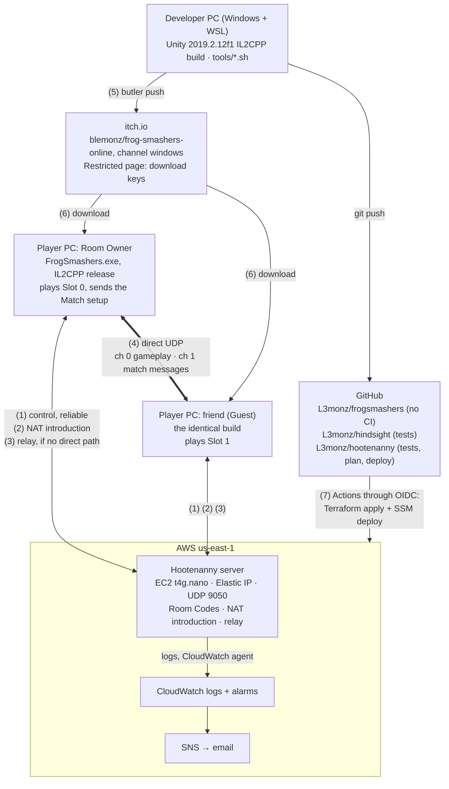

# 1. System context

Checked against: frogsmashers `7a5783a`, hindsight `c1e061b`, hootenanny `691b776`.

[Back to the project README](../README.md) · Next: [Inside one game](02-inside-one-game.md)

Who talks to whom, and over what. All game and server traffic is UDP through LiteNetLib 1.3.5,
the same version on both sides because its wire format changes between versions.

## The connections

| # | Between | What travels | How |
|---|---|---|---|
| 1 | each game ↔ server | Control messages. The game connects with `"HOOT"` and its protocol version, then sends `CreateRoom`, `JoinRoom` or `LeaveRoom`. The server sends `RoomCreated`, `RoomJoined`, `PeerArrived(token, isOwner)`, `PeerLeft` or `Error`. | Reliable, ordered |
| 2 | each game ↔ server | NAT introduction. Both games send a request carrying the Room's punch token. The server pairs them and tells each game the other's LAN and public address. | LiteNetLib `NatPunchModule` |
| 3 | game ↔ server ↔ game | The relay, used only when a direct connection can't be made. The server forwards a `RelayData` message (1-byte header plus the game's bytes) unchanged to the other member of the Room. Gameplay is forwarded unreliable and match messages reliable. Each Client is capped at 32 KB/s. | Mixed |
| 4 | game ↔ game | The direct path. Channel 0 carries Hindsight's input packets (unreliable, because they repeat every unacknowledged input). Channel 1 carries match messages: the Match setup and leaving (reliable, ordered). | Mixed |
| 5 | developer → itch.io | `tools/release-itch.sh` builds the release player and runs `butler push`. | HTTPS |
| 6 | itch.io → players | The download, with a download key. | HTTPS |
| 7 | GitHub → AWS | hootenanny's workflow assumes an AWS role through OIDC (no stored keys), applies Terraform and deploys through Systems Manager. | HTTPS |

## Worth knowing

- The game finds the server at a hard-coded address, `98.80.29.2` (`ServerLobby.DefaultServerHost`),
  the Elastic IP. `-rendezvous host:port` overrides it. A `terraform destroy` of the server
  releases that address, so the game would need a new release. See
  [Infrastructure and CI/CD](05-infrastructure-and-ci.md).
- On the direct path both games stay connected to the server for the whole Match, but losing the
  server doesn't end the Match. On the relay path it does.
- Two different builds never play each other: Hindsight's handshake compares build IDs (the
  short commit hash, plus `-dirty`).
- The server never runs the game. It keeps no accounts and no database, and forgets a Room when
  either player leaves.

## Code map

| In the diagram | Where |
|---|---|
| Room Owner plays Slot 0, friend Slot 1 | `frogsmashers: HohimBrueh/Assets/Scripts/Online/OnlineMatch.cs` (`LocalSlot`) |
| Server address | `frogsmashers: .../Online/ServerLobby.cs` (`DefaultServerHost`) |
| Control messages, relay header, Room Codes | `hootenanny: src/Hootenanny.Protocol/Protocol.cs` |
| Relay forwarding and the 32 KB/s cap | `hootenanny: src/Hootenanny.Server/HootServer.cs`, `RoomRegistry.cs` (`Limits`) |
| Channels 0 and 1, direct or relay | `frogsmashers: .../Online/LiteNetLibLink.cs` |
| EC2, Elastic IP, UDP 9050, alarms | `hootenanny: infra/server/main.tf`, `variables.tf` |
| itch.io target | `frogsmashers: tools/release-itch.sh` |
| GitHub workflows | `hootenanny: .github/workflows/ci.yml`, `hindsight: .github/workflows/test.yml` |
