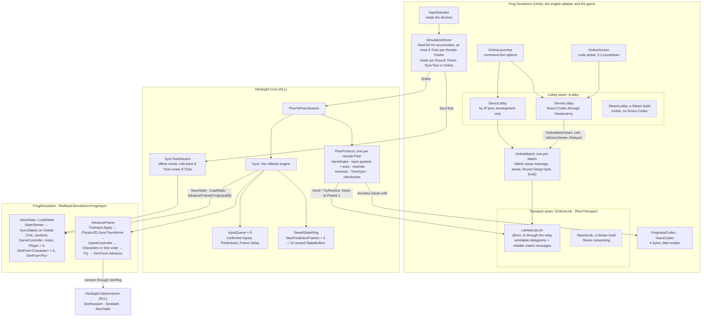

# 2. Inside one game

Checked against: frogsmashers `7a5783a`, hindsight `c1e061b`, hootenanny `691b776`.

[Back to the project README](../README.md) · Previous: [System context](01-system-context.md) · Next: [One online Tick](03-one-online-tick.md)

The pieces inside one running copy of Frog Smashers during an Online Match, and the two seams
that keep online play independent of how players meet and how bytes travel.

Dashed boxes are what a Steam build would add. Everything else stays the same.

## How to read it

- **Hindsight never opens a socket and never sees the game's types.** The game hands it a
  transport (`IPeerTransport`: send and receive bytes to an opaque `PeerId`), a codec, and a
  simulation with three methods. The Saved State is opaque bytes to it.
- **`SimulationDriver` is Frog Smashers' engine adapter.** It is the one place allowed to read the
  wall clock, and only to decide how many Ticks to run. It picks a mode when each Round starts:
  - **Direct**: one `AdvanceFrame` per Tick.
  - **SyncTest**: development builds and the editor. Proves determinism offline.
  - **Online**: through `PeerToPeerSession`.
- **Six Slots online too.** `RollbackConfig(playerCount: 6)` keeps the Saved State layout the
  same as offline. Online, Slot 0 is the Room Owner, Slot 1 the friend, and Slots 2 to 5 are unused:
  every Peer gives them a blank input and nothing is sent for them. Online settings:
  `MaxPredictionFrames = 8`, `FrameDelay = 2`.
- **A new session every Round.** `GameController` hands the scene's `FrogSimulation` to
  `SimulationDriver.BeginScene`, which starts a new `PeerToPeerSession` with that Round's seed and
  setup hash. The previous Round's session keeps answering for up to 2 s, so the other Peer
  receives the last inputs it needs.
- **Rollbacks are silent.** While `SimulationDriver.InRollback` is true, sounds, particles,
  popups and screen shake don't play again.
- **What a Steam build would swap:** only the two seams. A `SteamLobby : ILobby`
  (`UsesRoomCodes = false`, so the online screens hide code entry) and a
  `SteamLink : IOnlineLink` over Steam's networking. Hootenanny would not be needed. Hindsight,
  `SimulationDriver`, `FrogSimulation` and `OnlineMatch` would not change.

## Code map

Paths in frogsmashers are under `HohimBrueh/Assets/Scripts/`.

| In the diagram | Where |
|---|---|
| `OnlineScreen` | `frogsmashers: UI/OnlineScreen.cs` |
| `OnlineLauncher`, `ILobby`, `ServerLobby`, `DirectLobby` | `frogsmashers: Online/` |
| `OnlineMatch`, `IOnlineLink`, `LiteNetLibLink`, `FrogInputCodec` | `frogsmashers: Online/` |
| `SimulationDriver`, `InputSampler`, `FrogSimulation`, `StateStream`, `TickInput`, `SimPool`, `SimRng`, `SimClock` | `frogsmashers: Netcode/` |
| `PeerToPeerSession`, `PeerProtocol`, `Sync`, `InputQueue`, `SavedStateRing`, `TimeSync`, `SyncTestSession` | `hindsight: src/Hindsight.Core/` |
| `IRollbackSimulation`, `IPeerTransport`, `IInputCodec`, `StateBuffer` | `hindsight: src/Hindsight.Core/` |
| `SimRandom`, `SimMath`, `SineTable` | `hindsight: src/Hindsight.Determinism/` |
| The DLLs in the game | `frogsmashers: HohimBrueh/Assets/Plugins/Hindsight/`, copied by `tools/update-hindsight.sh` |
