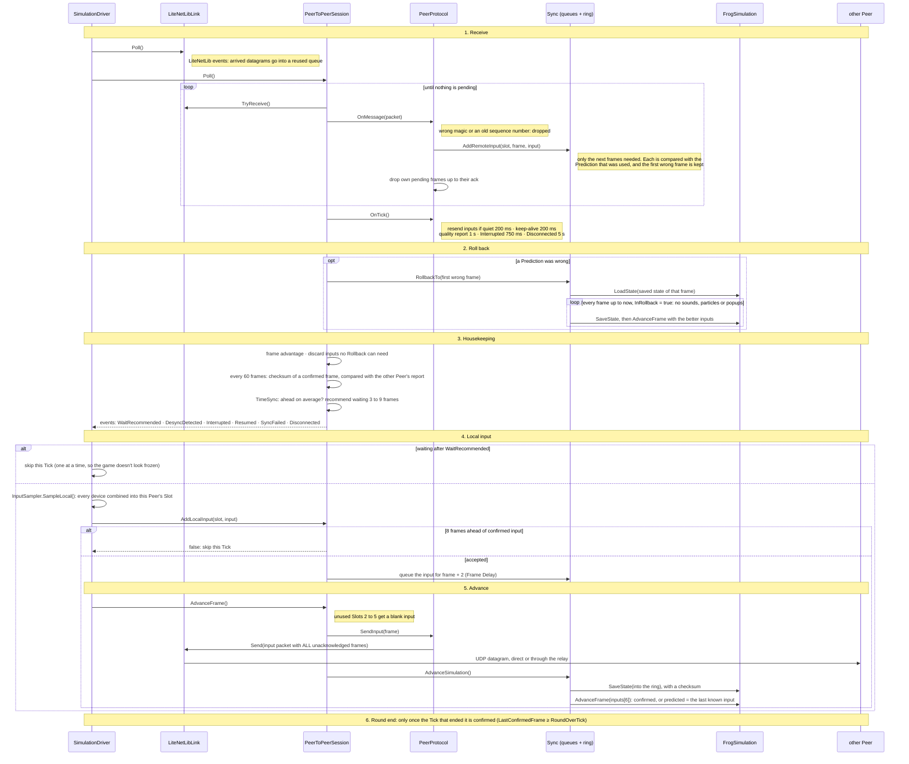

# 3. One online Tick

Checked against: frogsmashers `7a5783a`, hindsight `c1e061b`.

[Back to the project README](../README.md) · Previous: [Inside one game](02-inside-one-game.md) · Next: [Connecting](04-connecting.md)

What happens in one Tick of an Online Round, in order. `SimulationDriver.Update` adds the Render
Frame's time to an accumulator, and runs `AdvanceOneOnlineTick` once for every 1/60 s it holds,
at most 8 times per Render Frame.

## The sequence

## Prediction, in one paragraph

A remote input that hasn't arrived is predicted by repeating that player's last known input. The
simulation runs ahead on that guess, saving its state at the start of every frame. When the real
input arrives and differs, the session loads the Saved State of the first wrong frame and runs
every frame since again with the real inputs. It all happens inside one `Poll`, before this Tick's
own input. A Peer may run at most 8 frames ahead of the newest frame confirmed for every player.
Beyond that `AddLocalInput` refuses and the Tick is skipped. Frame Delay 2 holds the local input
back 2 Ticks (about 33 ms), which hides that much latency without any Rollback.

## The input packet

Little-endian. The 5-byte header is on every message.

| Offset | Size | Field | Notes |
|---|---|---|---|
| 0 | 2 | magic | Random per session, so packets from an old session are ignored. |
| 2 | 2 | sequence | Out-of-order packets are dropped: the newest one carries everything. |
| 4 | 1 | type | 4 = Input |
| 5 | 4 | first frame | The oldest frame in this packet. |
| 9 | 1 | frame count | How many frames follow. |
| 10 | 4 | ack frame | The newest of *their* frames this Peer holds. |
| 14 | 1 | advantage | This Peer's frame advantage, for TimeSync. |
| 15 | 4 | checksum frame | The frame of the latest checksum report. |
| 19 | 4 | checksum | That frame's Saved State checksum. |
| 23 | 4 × n | inputs | One `FrogInput` per frame (1 local player × 4 bytes). |

**Acknowledgements.** Each packet repeats every local frame the other Peer hasn't acknowledged,
and carries this Peer's own ack of theirs. A lost packet costs nothing: the next one carries the
same frames. When an ack arrives, the frames up to it leave the pending buffer. Packets stay under
1200 bytes.

The other message types are `SyncRequest`, `SyncReply` and `SyncReject` (see
[Connecting](04-connecting.md)), `QualityReport` and `QualityReply` (round-trip time),
`KeepAlive`, and `Disconnect` (sent 3 times).

## Code map

| Step | Where |
|---|---|
| Accumulator, `AdvanceOneOnlineTick`, events, Round end | `frogsmashers: HohimBrueh/Assets/Scripts/Netcode/SimulationDriver.cs` |
| Local input | `frogsmashers: .../Netcode/InputSampler.cs` (`SampleLocal`) |
| `Poll`, `AddLocalInput`, `AdvanceFrame`, checkpoints, wait | `hindsight: src/Hindsight.Core/PeerToPeerSession.cs` |
| Packets, acks, timers | `hindsight: src/Hindsight.Core/PeerProtocol.cs` (constants at the top) |
| Packet layout | `hindsight: src/Hindsight.Core/Messages.cs` |
| Rollback and the save-then-advance step | `hindsight: src/Hindsight.Core/Sync.cs` (`RollbackTo`, `AdvanceSimulation`) |
| Prediction, Frame Delay | `hindsight: src/Hindsight.Core/InputQueue.cs` |
| Saved States | `hindsight: src/Hindsight.Core/SavedStateRing.cs` |
| Waits | `hindsight: src/Hindsight.Core/TimeSync.cs` |
| Datagram queue | `frogsmashers: .../Online/LiteNetLibLink.cs` |
