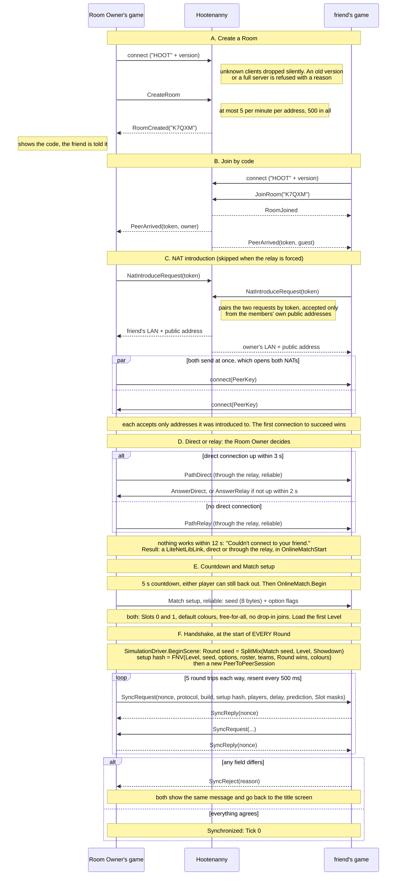

# 4. Connecting

Checked against: frogsmashers `7a5783a`, hindsight `c1e061b`, hootenanny `691b776`.

[Back to the project README](../README.md) · Previous: [One online Tick](03-one-online-tick.md) · Next: [Infrastructure and CI/CD](05-infrastructure-and-ci.md)

From "Create Room" to Tick 0. Each game does everything through one LiteNetLib socket: the NAT
introduction gives the other game the address the server saw, which is that socket's.

During the Match, both games stay connected to the server.

## What the handshake compares

`SyncRequest` carries a nonce and the facts both Peers must agree on. A mismatch is refused with
the first reason that applies:

| Field | Mismatch reason | What the player sees |
|---|---|---|
| Hindsight protocol version | `ProtocolVersion` | "Your friend is on a different version of the game." |
| Build ID hash (commit + `-dirty`) | `BuildId` | same |
| Round Setup hash | `RoundSetup` | "The two games disagree on the Round (…)." |
| Player count, Frame Delay, prediction limit, who owns which Slot | `SessionSettings` | same |

Five round trips prove the path works both ways and measure a first round-trip time.

## Leaving and failures

- Before the Match, any failure ends the lobby with a reason for the player:
  - "Couldn't reach the server." (8 s)
  - "Room not found."
  - "That Room is full."
  - "The Room expired." (a Room nobody joins closes after 10 minutes)
  - "Too many Rooms created."
  - "The server is full."
  - "This version of the game is too old for the server."
- During the Match, the leaving Peer's reason travels with its goodbye, so both players see the
  same message. Direct: in the LiteNetLib disconnect packet. Relay: as a reliable goodbye message.
- `-online-relay` (either player) forces the relay. `-rendezvous host:port` uses another server.
  Development builds can also skip the server: `-online-host PORT` / `-online-join HOST:PORT`
  (`DirectLobby`).

## Code map

| Step | Where |
|---|---|
| A to D, the game's side | `frogsmashers: HohimBrueh/Assets/Scripts/Online/ServerLobby.cs` (timeouts at the top) |
| A to C, the server's side | `hootenanny: src/Hootenanny.Server/HootServer.cs`, `RoomRegistry.cs`, `PunchMatcher.cs` |
| Messages and Room Codes | `hootenanny: src/Hootenanny.Protocol/Protocol.cs` |
| Countdown | `frogsmashers: .../UI/OnlineScreen.cs` (`CountdownSeconds`) |
| E, Match setup, seeds, setup hash | `frogsmashers: .../Online/OnlineMatch.cs` |
| F, starting the session per Round | `frogsmashers: .../Netcode/SimulationDriver.cs` (`BeginScene`, `StartOnlineSession`) |
| F, the handshake | `hindsight: src/Hindsight.Core/PeerProtocol.cs` (`SendSyncRequest`, `OnSyncRequest`) |
| Reasons shown to players | `frogsmashers: .../Netcode/SimulationDriver.cs` (`HandleOnlineEvents`), `ServerLobby.cs` (`Explain`) |
