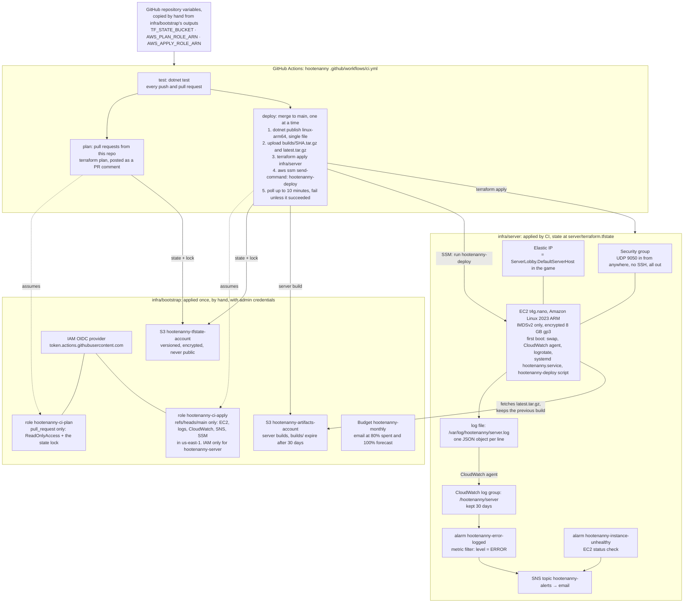
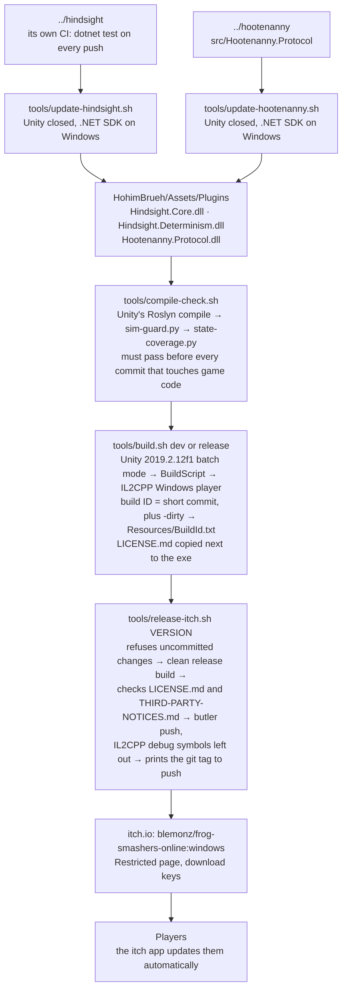

# 5. Infrastructure and CI/CD

Checked against: frogsmashers `7a5783a`, hindsight `c1e061b`, hootenanny `691b776`.

[Back to the project README](../README.md) · Previous: [Connecting](04-connecting.md)

There are two pipelines. The server deploys itself from GitHub to AWS. The game is built and
published from a developer's own PC, because there is no CI image that builds Unity 2019.2 with
IL2CPP for Windows.

## The server: Hootenanny on AWS

Things to know:

- A **new server build** is deployed in place through SSM, and the instance stays. A **changed
  `user-data.sh`** replaces the instance, and the Elastic IP moves to the new one. A newer base
  image alone changes nothing (`ignore_changes = [ami]`).
- `terraform destroy` releases the Elastic IP. The game has that address hard-coded
  (`ServerLobby.DefaultServerHost`, `98.80.29.2`), so after a destroy and re-apply the game needs
  a new release with the new address.
- When the game and the server both change their shared protocol, **deploy the server first**: it
  accepts the current and the previous protocol version.
- Log lines: `client.connected`, `room.created`, `room.joined`, `room.introduced`,
  `client.disconnected`. Also one `room.summary` per Room when it closes, and `server.stats`
  every minute.

## The game: built locally, published to itch.io

One-time setup on each developer PC: Unity 2019.2.12f1 with IL2CPP, Visual Studio C++ tools,
WSL, the .NET SDK, and `tools/patch-il2cpp-sockets.ps1` (as Administrator). Without that patch,
IL2CPP builds can't open sockets with newer Windows SDKs. Publishing also needs butler, logged in.

Hindsight has its own CI (`.github/workflows/test.yml`, `dotnet test` on every push), but nothing
publishes it: the game picks up a new Hindsight only when someone runs `update-hindsight.sh` and
commits the DLLs.

## Code map

| In the diagram | Where |
|---|---|
| Bootstrap stack | `hootenanny: infra/bootstrap/main.tf`, `github_role/main.tf`, `private_bucket/main.tf` |
| Server stack | `hootenanny: infra/server/main.tf`, `variables.tf`, `user-data.sh` |
| Workflow | `hootenanny: .github/workflows/ci.yml` |
| Log lines | `hootenanny: src/Hootenanny.Server/HootServer.cs`, `Log.cs` |
| Game scripts | `frogsmashers: tools/` |
| Build ID | `frogsmashers: HohimBrueh/Assets/Editor/Build/BuildScript.cs`, `HohimBrueh/Assets/Scripts/BuildInfo.cs` |
| Hindsight CI | `hindsight: .github/workflows/test.yml` |
